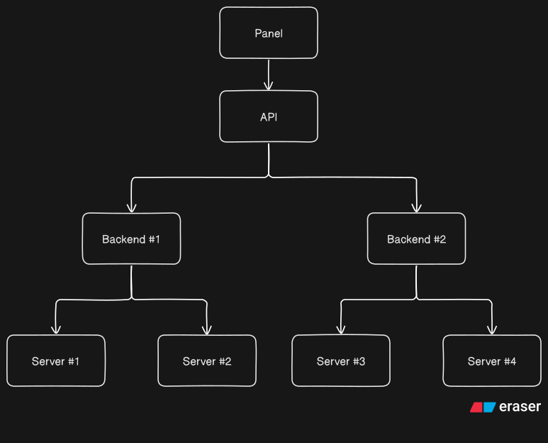

# Servion

Servion is a game [Docker](https://docker.com) management interface. For our users who don't know what Docker is, it is a containerization platform which allows for programs to run in an isolated environment away from the host operating system but within the same machine.

!!! warning "Early Access"

    Servion is in it's earliest stages of development. Expect issues. We do not recommend usage in production yet. Contributions are welcome.

The below information will help you understand how Servion functions, it's terminology and other information that may help you further understand it's role.

## Terminology

Terms or keywords that will be used throughout the documentation and the codebase related specifically to the panel.

### `Panel`

The primary instance that serves the interface to the client. It interlinks with the .NET API to fetch all needed information.

### `API`

This is a singular API that acts as a hub/interlinking point between the panel (frontend) and all paired backend instances. It stores things like users, etc. The difference between it and a backend is that there should only be one instance of it.

### `Backend`

A .NET instance separated from the primary codebase deployed to their own machines. A back-end is where servers will actually be created. This allows for expansion to multiple machines when deploying servers as you probably won't want all of your servers deployed on the root machine as you scale.

## Architecture

Now that you understand the terminology of the software, you can use the following diagram to get a visual representation of how it functions.

